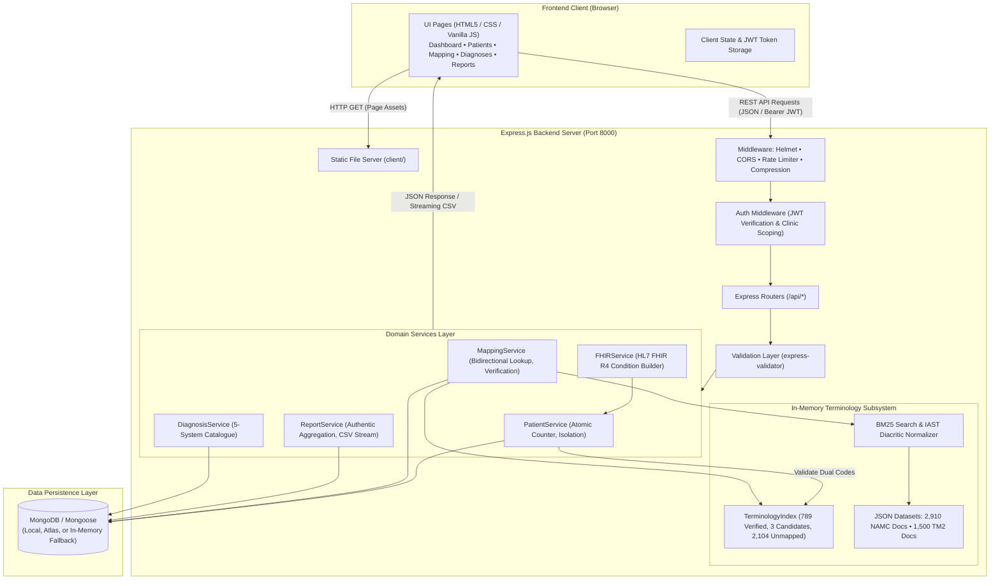

# CareSync — AYUSH and ICD-11 Diagnosis Connect

> Standardized clinical terminology crosswalk and dual-coding platform bridging traditional Indian medicine (AYUSH / NAMASTE) and the World Health Organization ICD-11 Traditional Medicine Module 2 (TM2).

---

## Table of Contents

1. [Project Overview](#1-project-overview)
2. [Key Features](#2-key-features)
3. [Screenshots](#3-screenshots)
4. [Technology Stack](#4-technology-stack)
5. [System Architecture](#5-system-architecture)
6. [Project Structure](#6-project-structure)
7. [Prerequisites](#7-prerequisites)
8. [Installation and Setup](#8-installation-and-setup)
9. [Environment Variables](#9-environment-variables)
10. [Terminology Data and Mapping Methodology](#10-terminology-data-and-mapping-methodology)
11. [API Documentation](#11-api-documentation)
12. [Reports and Analytics](#12-reports-and-analytics)
13. [Automated Testing](#13-automated-testing)
14. [Security and Privacy](#14-security-and-privacy)
15. [Limitations and Future Improvements](#15-limitations-and-future-improvements)
16. [Contributing](#16-contributing)
17. [License](#17-license)
18. [Author and Acknowledgements](#18-author-and-acknowledgements)

---

## 1. Project Overview

In clinical practice across India, traditional medical systems under the **AYUSH** umbrella (Ayurveda, Yoga & Naturopathy, Unani, Siddha, and Homeopathy) provide care to millions of individuals. However, diagnostic coding in traditional medicine has historically existed in isolation from modern healthcare IT standards, electronic health record (EHR) systems, and global morbidity reporting frameworks.

The Ministry of Ayush established the **NAMASTE** portal (National AYUSH Morbidity and Standardized Terminologies Electronic portal) and the **National Ayurveda Morbidity Codes (NAMC)** to provide structured codes for Ayurvedic disorders. Concurrently, the World Health Organization (WHO) introduced **Traditional Medicine Chapter 26 (Module 2 / TM2)** in **ICD-11**, creating the first global diagnostic classification for traditional medicine concepts originating in ancient India.

### The Problem

Without a standardized bridge between these systems:
* Traditional medicine diagnoses cannot be reliably communicated to modern biomedical EHRs.
* Dual-coding clinical records requires tedious manual searches across disconnected code tables and PDF compendia.
* Unverified or colloquial mappings risk clinical inaccuracies in patient charts.
* Traditional medicine morbidity data cannot be seamlessly incorporated into international public health reporting.

### The CareSync Solution

**CareSync** provides an intelligent, web-based platform that connects traditional Indian medicine terminology with WHO ICD-11 TM2 terminology:
* **Dual-Coded Clinical Records:** Allows clinicians to register patients with paired NAMASTE and ICD-11 TM2 codes simultaneously.
* **Bidirectional Terminology Lookup:** Enables instant resolution from a NAMC code to an ICD-11 TM2 code, or vice versa, with support for compound formatting.
* **BM25 Sanskrit-Aware Term Search:** Provides candidate retrieval tailored to Sanskrit terms, IAST diacritics, and Ayurvedic synonyms.
* **Clinician Verification Governance:** Establishes a formal workflow where qualified clinicians certify candidate pairings before they can be used for clinical documentation.
* **Interoperable FHIR R4 Export:** Generates standard HL7 FHIR R4 `Condition` JSON resources containing dual-coded terminology representations.
* **Clinic-Level Multi-Tenancy:** Ensures patient and diagnostic records remain isolated to authorized clinical facilities.

### Intended Users

* **AYUSH Clinicians and Practitioners:** For rapid terminology lookup, dual-coding diagnosis documentation, and patient registry management.
* **Hospital Administrators and Medical Coders:** For maintaining clinical governance, auditing dual-coded records, and exporting morbidity datasets.
* **Healthcare Researchers and Faculty:** For analyzing diagnostic distributions and studying terminology crosswalk alignment between NAMC and WHO ICD-11 TM2.

---

## 2. Key Features

### Implemented Features

* **Patient Registration and Management:**
  * Complete patient registry supporting demographic capture, clinical status tagging (`stable`, `critical`, `review`), and soft-deletion.
  * Automated sequential patient code generation (`P001`, `P002`, ...) with atomic database counters preventing duplicates under concurrent submissions.
  * Strict terminology validation during registration: patient records are only created when paired codes match an officially verified crosswalk.
  * Clinic-scoped data isolation ensuring clinics only view and modify their own patient records.

* **AYUSH / NAMASTE Terminology Lookup:**
  * Exact and parenthetical code lookup supporting canonical compound codes (e.g., `SP51(EC-3)`), bare morbidity codes (e.g., `EC-3`), and standard prefixes.
  * Case-insensitive, whitespace-normalized query processing.

* **ICD-11 TM2 Terminology Lookup:**
  * Lookup by official WHO ICD-11 TM2 alphanumeric code (e.g., `SP51`, `SR11`, `SK51`).
  * Direct retrieval of WHO concept titles, parent hierarchy categories, and Foundation URIs.

* **Bidirectional Terminology Search:**
  * Symmetric resolution: entering either a NAMC or an ICD-11 code automatically returns the corresponding paired code and diagnosis details.
  * Free-text search powered by a custom BM25 Information Retrieval algorithm supporting Sanskrit terms, IAST diacritics (e.g., `jvaraḥ`, `viśvācī`), and English synonyms.

* **Crosswalk Management and Verification Workflows:**
  * Strict distinction between **verified crosswalks** (certified pairings) and **unverified candidates** (algorithmic suggestions requiring review).
  * Doctor-level certification interface to confirm candidate relationships (`equivalent`, `broader`, `narrower`, `related`) and specify official WHO entity URIs.
  * Conflict prevention: attempts to map conflicting entities or duplicate pairings are safely rejected.
  * Synchronization between global terminology crosswalks and clinic-level mapping histories.

* **Diagnosis Catalogue:**
  * Browsable library across 5 AYUSH streams: Ayurveda, Yoga & Naturopathy, Unani, Siddha, and Homeopathy.
  * Live filtering by disorder name, subtitle, or clinical code.
  * Diagnostic cards indicating dual-coding readiness and FHIR export capability.

* **Reports and Analytics:**
  * Overview metrics displaying verified terminology catalogue size, active clinic patient encounters, and unique diagnostic concepts.
  * Morbidity distribution chart showing patient volume across AYUSH medical streams.
  * 6-month dual-coding volume trend chart based on authentic clinic encounter timestamps.
  * Honest empty-state indicators for unavailable integrations (e.g., insurance claims show an explicit unavailable status rather than fabricated approval percentages).

* **CSV Data Exports:**
  * Live streaming CSV export of clinic morbidity records (`/api/reports/export`).
  * Downloadable CSV audit files of confirmed terminology mappings (`/api/reports/download/:id`).
  * Batch CSV upload interface for queuing diagnosis terms for bulk dual-coding (`/api/mapping/bulk-upload`).

* **Authentication and Security:**
  * Email/password and ABHA ID login with bcrypt password hashing and JSON Web Tokens (JWT).
  * Rate-limited login endpoints to mitigate brute-force attempts.
  * Clinic multi-tenancy enforcing strict data isolation across routes.
  * Simulated ABHA authentication sandbox endpoint with clear graceful fallbacks.

* **FHIR R4 Interoperability Utility:**
  * Dynamic generation of standard HL7 FHIR Release 4 `Condition` JSON resources for any registered patient.
  * Dual-coded representation including both NAMASTE code system URI (`https://namstp.ayush.gov.in/#/namaste`) and WHO ICD-11 URI (`http://id.who.int/icd/release/11/mms`).
  * In-browser FHIR inspector with one-click copy-to-clipboard functionality.

### Planned Features (Future Roadmap)

* Live ABDM (Ayushman Bharat Digital Mission) gateway integration for production ABHA OTP verification.
* Direct real-time synchronization with the official WHO ICD-11 API using OAuth 2.0 client credentials.
* Dense vector semantic search (BioBERT / clinical embeddings) to complement sparse BM25 retrieval.
* Expansion of verified crosswalk datasets to Unani, Siddha, and Homeopathy national morbidity codes.
* Integration with insurance claims clearinghouses for automated claim filing with dual-coded diagnostics.

---

## 3. Screenshots

*Visual previews of the CareSync interface will be added to this section in future documentation updates.*

```text
To add screenshots to your fork or local copy:
1. Capture screenshots of the relevant interfaces:
   - Dashboard (Overview KPIs and Triage Feed)
   - Patient Management (Patient Table and Multi-Tab Detail Modal)
   - Disease Mapping (Code Lookup and Sanskrit BM25 Search)
   - Diagnoses Library (5-System Catalogue and Detail Modal)
   - Reports & Analytics (System Breakdown and Volume Trend)
   - FHIR Inspector (Standard HL7 FHIR R4 Condition JSON)
2. Place PNG or JPG files in a `docs/screenshots/` directory within the repository.
3. Link them here using standard Markdown image syntax: ``.
```

---

## 4. Technology Stack

### Frontend Client

| Technology | Purpose |
|---|---|
| **HTML5 & CSS3** | Semantic structure and responsive layout |
| **Vanilla JavaScript (ES6+)** | Frontend application logic, DOM manipulation, and REST API communication |
| **Custom CSS Design System** | Glassmorphic cards, typography tokens, and persistent Light / Dark mode themes |
| **Bootstrap 5.3 (CDN)** | Responsive layout utilities and accessible modal dialogs |
| **Chart.js 4.4 (CDN)** | Interactive data visualizations (morbidity breakdown and monthly volume trends) |
| **Font Awesome 6 (CDN)** | Clinical, diagnostic, and interface iconography |

### Backend API Server

| Technology | Purpose |
|---|---|
| **Node.js (v18+)** | JavaScript runtime environment |
| **Express.js (4.19)** | RESTful API routing, middleware pipeline, and static client hosting |
| **Mongoose (8.5)** | Object Data Modeling (ODM) for MongoDB with schema validation and indexing |
| **jsonwebtoken (9.0)** | Stateless authentication with signed JWT tokens |
| **bcryptjs (2.4)** | Cryptographic password hashing |
| **express-validator (7.1)**| Request body and query parameter validation and sanitization |
| **helmet (7.1)** | Security HTTP headers |
| **cors (2.8)** | Cross-Origin Resource Sharing configuration |
| **express-rate-limit (7.3)**| IP-based request throttling on sensitive endpoints (e.g., login) |
| **compression (1.7)** | Gzip response compression |
| **morgan (1.10)** | HTTP request logging for development environments |
| **multer (1.4)** | Multipart form data handling for batch CSV uploads and profile images |
| **xlsx (0.18)** | Server-side Excel parsing for National Ayurveda Morbidity Codes ingestion |

### Database and In-Memory Fallback

| Technology | Purpose |
|---|---|
| **MongoDB** | Primary persistent document database (Atlas or local instance) |
| **mongodb-memory-server (9.2)** | Zero-configuration ephemeral in-memory database fallback for seamless local evaluation and automated testing without an external MongoDB server |

### Terminology and Information Retrieval Subsystem

| Technology | Purpose |
|---|---|
| **BM25 Information Retrieval** | In-memory Okapi BM25 ranking algorithm for sparse text retrieval |
| **IAST Sanskrit Normalizer** | Diacritic folding (`ā` → `a`, `ś` → `s`, `ḥ` → `h`, etc.) and Sanskrit suffix handling |
| **JSON Concept Catalogues** | In-memory indexing of 2,910 NAMC documents and 1,500 WHO ICD-11 TM2 concepts |

---

## 5. System Architecture

CareSync is built as a modular client-server web application. The backend serves both the RESTful API endpoints and the static frontend assets from a single Node.js runtime.

### Request and Data Flow



---

## 6. Project Structure

```text
Aayush-ICD-Connect/
├── client/                               # Frontend user interface
│   ├── index.html                        # Authentication and login portal
│   ├── dashboard.html                    # Clinical dashboard and summary KPIs
│   ├── patients.html                     # Patient management and FHIR inspector
│   ├── mapping.html                      # Disease mapping and terminology lookup
│   ├── diagnoses.html                    # 5-system AYUSH diagnoses library
│   ├── reports.html                      # Morbidity analytics and CSV exports
│   ├── settings.html                     # User profile, preferences, and security
│   ├── script.js                         # Dynamic frontend application logic (122 KB)
│   └── style.css                         # Unified responsive styling and theme tokens (80 KB)
│
├── server/                               # Node.js backend server and data processing
│   ├── package.json                      # Server scripts and dependency manifest
│   ├── package-lock.json                 # Pinned dependency lockfile
│   ├── .env.example                      # Configuration template with placeholders
│   │
│   ├── data/                             # Raw and processed terminology datasets
│   │   ├── mappings/
│   │   │   └── namaste_icd11_tm2_crosswalk.json  # Baseline crosswalk seed (9 records)
│   │   └── rag/
│   │       ├── namc/
│   │       │   └── NATIONAL AYURVEDA MORBIDITY CODES_2.xlsx  # Official NAMC source
│   │       └── processed/
│   │           ├── namc_documents.json           # 2,910 processed Ayurveda documents
│   │           └── icd11_tm2_documents.json      # 1,500 WHO TM2 concepts
│   │
│   ├── src/                              # Backend application source code
│   │   ├── server.js                     # HTTP server startup and graceful shutdown
│   │   ├── app.js                        # Express app, middleware, and route mounting
│   │   │
│   │   ├── config/                       # Configuration modules
│   │   │   ├── db.js                     # MongoDB connection with in-memory fallback
│   │   │   ├── env.js                    # Environment variable loader
│   │   │   └── uploads.js                # Multer upload storage configurations
│   │   │
│   │   ├── controllers/                  # Route handlers
│   │   │   ├── authController.js         # Login, registration, password management
│   │   │   ├── dashboardController.js    # Dashboard summary aggregations
│   │   │   ├── diagnosisController.js    # Diagnosis catalogue management
│   │   │   ├── mappingController.js      # Terminology lookup, search, verification
│   │   │   ├── notificationController.js # Notifications and read status
│   │   │   ├── patientController.js      # Patient CRUD, validation, and FHIR export
│   │   │   ├── publicController.js       # Public system statistics
│   │   │   ├── reportController.js       # Authentic reports and streaming CSV exports
│   │   │   └── settingsController.js     # User profile and clinical preferences
│   │   │
│   │   ├── middleware/                   # Express middleware
│   │   │   ├── auth.js                   # JWT verification and RBAC enforcement
│   │   │   ├── errorHandler.js           # Centralized JSON error response handler
│   │   │   └── validate.js               # express-validator result handler
│   │   │
│   │   ├── models/                       # Mongoose data schemas (12 models)
│   │   │   ├── AnalyticsSnapshot.js      # Historical report snapshots
│   │   │   ├── AuditLog.js               # Clinical mutation audit trail
│   │   │   ├── Clinic.js                 # Clinic multi-tenancy organization
│   │   │   ├── Counter.js                # Atomic sequential ID counter
│   │   │   ├── Diagnosis.js              # Standardized catalogue entries
│   │   │   ├── Mapping.js                # Clinic-confirmed mapping records
│   │   │   ├── MappingEvidence.js        # Algorithmic candidate evidence
│   │   │   ├── Notification.js           # In-app notifications
│   │   │   ├── Patient.js                # Patient demographics and dual codes
│   │   │   ├── Report.js                 # Exported report file metadata
│   │   │   ├── TerminologyCrosswalk.js   # Authoritative verified crosswalks
│   │   │   └── User.js                   # User credentials, roles, and profiles
│   │   │
│   │   ├── rag/                          # Information retrieval subsystem
│   │   │   ├── ingestion/                # Excel and JSON data parser utilities
│   │   │   └── retrieval/
│   │   │       └── bm25.js               # BM25 engine with Sanskrit normalizer
│   │   │
│   │   ├── routes/                       # Express router definitions
│   │   │   ├── authRoutes.js             # /api/auth routes
│   │   │   ├── dashboardRoutes.js        # /api/dashboard routes
│   │   │   ├── diagnosisRoutes.js        # /api/diagnoses routes
│   │   │   ├── mappingRoutes.js          # /api/mapping routes
│   │   │   ├── notificationRoutes.js     # /api/notifications routes
│   │   │   ├── patientRoutes.js          # /api/patients routes
│   │   │   ├── publicRoutes.js           # /api/public routes
│   │   │   ├── reportRoutes.js           # /api/reports routes
│   │   │   └── settingsRoutes.js         # /api/settings routes
│   │   │
│   │   ├── seed/                         # Initial database seeding
│   │   │   └── seedDemoData.js           # Idempotent crosswalk, user, and demo seeder
│   │   │
│   │   └── services/                     # Business logic and domain services
│   │       ├── auditService.js           # Mutation auditing
│   │       ├── authService.js            # Password hashing, JWT signing
│   │       ├── dashboardService.js       # Live metrics calculation
│   │       ├── diagnosisService.js       # Catalogue queries
│   │       ├── fhirService.js            # HL7 FHIR R4 Condition resource builder
│   │       ├── mappingService.js         # Bidirectional resolution and verification
│   │       ├── notificationService.js    # System alerts
│   │       ├── patientService.js         # Atomic P001-series patient registration
│   │       ├── publicService.js          # Anonymous statistics
│   │       ├── reportService.js          # Authentic metrics, CSV streaming
│   │       ├── settingsService.js        # Profile and preference updates
│   │       └── terminologyIndex.js       # 2,910-record in-memory crosswalk index
│   │
│   └── test_*.js                         # Automated verification and regression test suites
│
└── README.md                             # Comprehensive project documentation
```

---

## 7. Prerequisites

Before installing and running the project, ensure you have the following installed:

1. **Node.js:** Version `18.0.0` or higher (tested on Node.js v18 and v20; minimum supported: v16.14.0).
   * Verify installation: `node -v`
2. **npm:** Version `9.0.0` or higher (bundled with Node.js).
   * Verify installation: `npm -v`
3. **Web Browser:** Any modern web browser (Google Chrome, Mozilla Firefox, Microsoft Edge, or Apple Safari).
4. **MongoDB (Optional):**
   * **Not required for local development or evaluation.** If no MongoDB connection string is provided, CareSync automatically launches an embedded in-memory MongoDB instance via `mongodb-memory-server`.
   * For persistent deployments: a local MongoDB instance (`mongodb://127.0.0.1:27017/`) or a MongoDB Atlas cluster URI.

---

## 8. Installation and Setup

Follow these step-by-step instructions to get CareSync running locally:

### Step 1: Clone the Repository

```bash
git clone https://github.com/sonuprasad100e-eng/Aayush-ICD-Connect.git
cd Aayush-ICD-Connect
```

### Step 2: Install Server Dependencies

Navigate to the `server` directory and install the required npm packages:

```bash
cd server
npm install
```

### Step 3: Configure Environment Variables (Optional)

Create a `.env` file from the provided example template:

```bash
cp .env.example .env
```

*For quick local testing, you can leave `.env` empty or omit it entirely. CareSync will automatically use default settings and start an in-memory database.*

### Step 4: Seed Initial Data (Optional)

Demo data seeds automatically when the server starts with an empty database. If you wish to explicitly run the seeding script:

```bash
npm run seed
```

This populates the database with:
* The authoritative baseline terminology crosswalks (6 verified and 3 candidate records).
* Standardized diagnosis catalogue entries across 5 AYUSH systems.
* Two demonstration clinic facilities (Patanjali Ayush Kendra and National Homeopathy Clinic) with associated doctor accounts.

### Step 5: Start the Server

Start the application using the standard npm script:

```bash
npm start
```

For development mode with automatic restart on file edits:

```bash
npm run dev
```

The terminal will display the startup banner:

```text
====================================================
Care Sync Backend running at: http://localhost:8000
Frontend UI accessible at:    http://localhost:8000/
API Health Check:             http://localhost:8000/api/health
Environment:                  development
====================================================
```

### Step 6: Access the Application

Open your browser and navigate to:

```text
http://localhost:8000
```

The Express server serves the static frontend client from `client/` at the root URL.

### Demonstration Login Accounts

When running with pre-seeded data, the following credentials are available:

| Clinic | Role | Email / Identifier | Password | ABHA ID |
|---|---|---|---|---|
| **Patanjali Ayush Kendra** | Doctor | `sonu@caresync.in` *(or `doctor@caresync.in`)* | `password123` | `12-3456-7890-1234` |
| **National Homeopathy Clinic** | Doctor | `dr.sharma@ayushcare.in` | `password123` | `98-7654-3210-9876` |

*You may also use the **Register** link on the login page to create a new clinic and administrator account.*

---

## 9. Environment Variables

Environment variables are configured in `server/.env`. The application reads them via `dotenv`.

| Variable | Description | Required? | Default / Example Value |
|---|---|---|---|
| `PORT` | HTTP port on which the Express server listens | Optional | `8000` |
| `NODE_ENV` | Application runtime environment (`development`, `test`, `production`) | Optional | `development` |
| `CLIENT_URL` | Base URL of the client application for CORS handling | Optional | `http://localhost:8000` |
| `MONGODB_URI` | MongoDB connection URI. **Leave empty to use automatic in-memory MongoDB** | Optional | `mongodb://127.0.0.1:27017/aayush_icd_connect` |
| `JWT_SECRET` | Secret key used to sign and verify JSON Web Tokens | Required for production | `your_jwt_secret_key_change_in_production` |
| `ICD_API_CLIENT_ID` | Client ID for official WHO ICD-11 API (leave blank for offline dataset) | Optional | `your_who_icd_client_id_here` |
| `ICD_API_CLIENT_SECRET`| Client Secret for official WHO ICD-11 API | Optional | `your_who_icd_client_secret_here` |

> **Security Note:** Never commit `.env` containing sensitive credentials or production JWT secrets to source control. The `.gitignore` file is configured to exclude `.env`.

---

## 10. Terminology Data and Mapping Methodology

A central objective of CareSync is maintaining terminology precision when connecting traditional Indian medicine diagnoses with global WHO classifications.

### Actual Ingested Datasets

CareSync utilizes curated datasets located in `server/data/`:

1. **National Ayurveda Morbidity Codes (NAMC):**
   * Sourced from the Ministry of Ayush official Excel publication (`NATIONAL AYURVEDA MORBIDITY CODES_2.xlsx`).
   * Contains exactly **2,910** structured Ayurveda morbidity concepts stored in `server/data/rag/processed/namc_documents.json`.
   * Records include morbidity codes (e.g., `EC-3`, `AAA-1`, `AAC-35`), Sanskrit disease names (e.g., `jvaraH`, `vAtasa~jcayaH`, `viSvAcI`), English descriptions, and disease categories.

2. **WHO ICD-11 Traditional Medicine Module 2 (TM2):**
   * Sourced from the WHO ICD-11 Foundation and MMS release for Chapter 26 (Traditional Medicine Module 2).
   * Contains exactly **1,500** concepts stored in `server/data/rag/processed/icd11_tm2_documents.json`.
   * Records include Foundation entity URIs, assigned alphanumeric codes (e.g., `SP51`, `SR11`, `SK51`), concept titles, parent hierarchy classifications, and international synonyms.

### Terminology Index Composition

The application loads an in-memory `TerminologyIndex` (`server/src/services/terminologyIndex.js`) containing:
* **789 Verified Mappings:** Concept pairings verified through authoritative dual-coded Morbidity Codes (e.g., `SP51(EC-3)` mapping to WHO TM2 code `SP51` and NAMC code `EC-3`).
* **3 Unverified Candidate Mappings:** Algorithmic suggestions pending clinician review (e.g., `AYU-0205` ↔ `SP80`).
* **2,104 Unmapped NAMC Concepts:** Official Ayurveda concepts from the catalogue that do not yet have an authoritative ICD-11 TM2 counterpart.
* **400 Unique WHO TM2 Codes:** Represented across the verified pairings.

### Verified Crosswalks vs. Unverified Candidates

To prevent diagnostic inaccuracies:
* **Verified Crosswalks (`verified: true`):**
  * Represent pairings established through authoritative source crosswalks or certified by a registered clinician.
  * Approved for direct bidirectional lookup and immediate patient registration.
  * Documented with verification metadata: verifying doctor ID, timestamp, verification method (`official_crosswalk` or `doctor_review`), and relationship type (`equivalent`, `broader`, `narrower`, `related`).
* **Unverified Candidates (`verified: false`):**
  * Suggestions identified by algorithmic search or preliminary crosswalk proposals.
  * Returned with `hasUnverifiedCandidate: true` and HTTP 404 in strict lookup endpoints.
  * **Strictly rejected** by the patient registration service: attempting to register a patient with unverified codes returns HTTP 400 Bad Request, instructing the clinician to complete verification in the Disease Mapping module first.

### Clinical Governance and Relationship Types

Diagnoses originating in different epistemological systems rarely exhibit exact 1-to-1 identity. CareSync enforces clinical governance by recording relationship types:

| Relationship Type | Meaning | Example |
|---|---|---|
| `equivalent` | Clinical concepts align in diagnostic scope and etiology | *Jvara (Ayurveda)* ↔ *Fever disorder (TM2)* |
| `broader` | The traditional medicine term encompasses a wider spectrum than the mapped code | *Amavata* mapped to a specific inflammatory joint entity |
| `narrower` | The traditional medicine term represents a specific sub-type of the mapped category | A specific sub-dosha variant mapped to a generalized disorder |
| `related` | Concepts share symptomatic or pathological overlap without hierarchical identity | Functional syndrome comparisons |

---

## 11. API Documentation

All API endpoints are prefixed with `/api` and return standardized JSON responses. Protected routes require a valid JWT token passed in the `Authorization` header: `Bearer <token>`.

### Authentication Endpoints (`/api/auth`)

| Method | Endpoint | Description | Auth Required |
|---|---|---|---|
| `POST` | `/api/auth/login` | Doctor / Administrator login via email or ABHA ID (rate limited) | No |
| `POST` | `/api/auth/register` | Register a new clinic facility and doctor account | No |
| `POST` | `/api/auth/abha-auth` | Simulated ABHA ID authentication gateway | No |
| `POST` | `/api/auth/forgot-password` | Initiate password recovery | No |
| `GET` | `/api/auth/me` | Retrieve profile of the currently logged-in user | Yes |
| `POST` | `/api/auth/logout` | Invalidate current user session | Yes |
| `POST` | `/api/auth/change-password` | Update account password | Yes |

### Patient Management Endpoints (`/api/patients`)

| Method | Endpoint | Description | Auth Required |
|---|---|---|---|
| `GET` | `/api/patients` | Search, filter, and paginate clinic patient records | Yes |
| `POST` | `/api/patients` | Register a new patient with dual codes (validates verified crosswalk) | Yes |
| `GET` | `/api/patients/:id` | Retrieve full patient record by ID | Yes |
| `PUT` | `/api/patients/:id` | Update patient demographics or clinical status (`stable`, `critical`, `review`) | Yes |
| `DELETE` | `/api/patients/:id` | Soft-delete a patient record | Yes |
| `GET` | `/api/patients/:id/fhir` | Generate and export standard HL7 FHIR R4 `Condition` JSON resource | Yes |

### Disease Mapping and Terminology Endpoints (`/api/mapping`)

| Method | Endpoint | Description | Auth Required |
|---|---|---|---|
| `GET` | `/api/mapping/lookup` | Bidirectional lookup by code (`?code=SP51` or `?code=EC-3`) | Yes |
| `GET` | `/api/mapping/search` | Term search with confidence scoring | Yes |
| `GET` | `/api/mapping/candidates` | Retrieve candidate matches using the BM25 retrieval engine | Yes |
| `POST` | `/api/mapping/verify` | Certify clinical candidate equivalence and record WHO Entity URI | Yes (Doctor) |
| `POST` | `/api/mapping/verify-official-code` | Verify WHO entity with official alphanumeric code | Yes (Doctor) |
| `POST` | `/api/mapping/confirm` | Confirm and record a dual-coding mapping in clinic history | Yes |
| `GET` | `/api/mapping/recent` | List recently confirmed mappings for the clinic | Yes |
| `GET` | `/api/mapping/stats` | Mapping accuracy, volume, and verification statistics | Yes |
| `POST` | `/api/mapping/bulk-upload` | Upload CSV batch file for terminology dual-coding | Yes |

### Diagnoses Catalogue Endpoints (`/api/diagnoses`)

| Method | Endpoint | Description | Auth Required |
|---|---|---|---|
| `GET` | `/api/diagnoses` | Filter diagnoses by AYUSH system (`ayurveda`, `yoga`, `unani`, `siddha`, `homeopathy`) | Yes |
| `POST` | `/api/diagnoses` | Add a new standardized catalogue entry | Yes |
| `GET` | `/api/diagnoses/:id` | Retrieve single diagnosis catalogue record | Yes |
| `PUT` | `/api/diagnoses/:id` | Update catalogue diagnosis details | Yes |
| `DELETE` | `/api/diagnoses/:id` | Remove diagnosis from catalogue | Yes |

### Reports and Analytics Endpoints (`/api/reports`)

| Method | Endpoint | Description | Auth Required |
|---|---|---|---|
| `GET` | `/api/reports/overview` | Authentic clinic overview KPIs (patients, unique concepts, catalogue size) | Yes |
| `GET` | `/api/reports/system-breakdown` | Patient distribution across AYUSH medical systems | Yes |
| `GET` | `/api/reports/trend` | Chronological monthly dual-coding volume trend series | Yes |
| `GET` | `/api/reports/files` | List authentic downloadable report files | Yes |
| `GET` | `/api/reports/export` | Stream live clinic morbidity encounters as a standard CSV file | Yes |
| `GET` | `/api/reports/download/:id` | Download a specific pre-generated audit report file | Yes |

### User Settings and Notifications Endpoints (`/api/settings`, `/api/notifications`)

| Method | Endpoint | Description | Auth Required |
|---|---|---|---|
| `GET` | `/api/settings` | Retrieve user preferences, clinic details, and security settings | Yes |
| `PUT` | `/api/settings/profile` | Update profile information | Yes |
| `POST` | `/api/settings/photo` | Upload user profile avatar (Multipart) | Yes |
| `PUT` | `/api/settings/security` | Update account security preferences | Yes |
| `PUT` | `/api/settings/preferences` | Update clinical preferences (default system, language, dark mode) | Yes |
| `PUT` | `/api/settings/notifications` | Update notification triggers | Yes |
| `GET` | `/api/notifications` | Retrieve clinic notifications and unread counter | Yes |
| `PUT` | `/api/notifications/read-all` | Mark all notifications as read | Yes |
| `PUT` | `/api/notifications/:id/read` | Mark a specific notification as read | Yes |

### Public and Health Endpoints

| Method | Endpoint | Description | Auth Required |
|---|---|---|---|
| `GET` | `/api/health` | Backend service health check | No |
| `GET` | `/api/public/stats` | Anonymous platform summary statistics | No |

---

## 12. Reports and Analytics

The Reports & Analytics module provides operational insights based strictly on authentic application data. CareSync avoids generating fabricated, random, or hardcoded metrics:

### Data Sources and Metrics

* **Total Diagnoses (2,910):** Represents the actual verified terminology catalogue size (derived from the 2,910 processed NAMC documents in `server/data/rag/processed/namc_documents.json`).
* **Active Clinic Cases:** Directly aggregated from `Patient.countDocuments({ clinicId, isDeleted: false })`. Shows `0` when no patients have been registered.
* **Unique Clinical Concepts:** Computed by grouping distinct `namasteCode` values across active patients in the clinic.
* **AYUSH System Breakdown:** Aggregated from the clinic's actual registered patient diagnoses. If a clinic has only registered Ayurveda patients, Ayurveda displays 100% and other systems display 0%.
* **Monthly Dual-Coding Volume:** Groups confirmed patient encounters into 6 chronological monthly buckets using genuine database timestamps. Months with no activity accurately report 0.

### Honest Status of Insurance Claims

Currently, CareSync **does not include an active insurance claims clearinghouse integration**. Consequently:
* The overview endpoint returns `claims: { available: false, approvedRate: null, rejectedRate: null }`.
* The reports UI displays an explicit empty state banner explaining that insurance claim processing is pending payer gateway integration, rather than displaying fabricated approval/rejection rates.
* Attempting to download non-existent claim files returns HTTP 404 with an honest explanation.

### CSV Streaming Exports

* **Morbidity Export (`GET /api/reports/export`):** Streams a standard CSV file directly from the database with columns: `Patient Code`, `Name`, `Age`, `Diagnosis`, `NAMASTE Code`, `ICD-11 TM2 Code`, `Status`, `Date Recorded`. Clinic isolation is strictly enforced.
* **Mapping Audit Export (`GET /api/reports/download/rep-mapping`):** Streams a CSV containing confirmed dual-coding mappings, confidence scores, and verifying clinicians.

---

## 13. Automated Testing

CareSync includes comprehensive, isolated regression and integration test suites. The tests run against an ephemeral in-memory MongoDB instance without touching production or persistent data.

### Verified Test Suites

All automated test suites have been executed and verified in the project environment:

| Test Script | Tested Scope | Assertions Passed |
|---|---|---|
| `test_comprehensive_terminology_index.js` | 2,910 NAMC docs, 1,500 TM2 docs, 789 verified index, bidirectional lookup, format syntax, diacritic search, patient validation | **61 / 61 passed** |
| `test_automatic_terminology_lookup.js` | Symmetric NAMC ↔ ICD-11 lookup, whitespace/case normalization, canonical compound codes, unverified candidate handling | **68 / 68 passed** |
| `test_reports_trustworthy_analytics.js` | Zero-fabricated defaults, authentic patient aggregation, clinic isolation, honest claims state, genuine CSV streaming | **46 / 46 passed** |
| `test_phase2c_mapping_sync.js` | Clinician verification flow, crosswalk synchronization, dashboard stats, duplicate rejection, clinic scoping | **64 / 64 passed** |
| `test_phase2b_crosswalk_seeding.js` | Idempotent crosswalk seeding, 6 verified + 3 candidate partitioning, patient registration gating | **56 / 56 passed** |
| `test_patient_id_generation.js` | Atomic sequential patient IDs (`P001`), 10 parallel concurrent requests, restart persistence, duplicate prevention | **39 / 39 passed** |
| `test_verify_official_code.js` | RBAC doctor verification, official WHO entity code entry, conflicting pairing rejection | **21 / 21 passed** |
| `test_functionality_audit.js` | End-to-end integration audit covering Auth, ABHA fallback, Notifications, CSV exports, and clinic isolation | **7 / 7 passed** |

### Running the Test Suites

To run any of the automated test suites, navigate to the `server/` directory and execute the test script with Node.js:

```bash
cd server

# Run the comprehensive terminology index test suite (61 tests)
node test_comprehensive_terminology_index.js

# Run the automatic terminology lookup test suite (68 tests)
node test_automatic_terminology_lookup.js

# Run the trustworthy analytics and reports test suite (46 tests)
node test_reports_trustworthy_analytics.js

# Run the patient registration and atomic ID generation test suite (39 tests)
node test_patient_id_generation.js

# Run the crosswalk seeding and synchronization test suites
node test_phase2b_crosswalk_seeding.js
node test_phase2c_mapping_sync.js

# Run the official code verification test suite
node test_verify_official_code.js

# Run the complete end-to-end functionality audit
node test_functionality_audit.js
```

---

## 14. Security and Privacy

CareSync incorporates security best practices designed to safeguard patient records and clinical credentials:

1. **Environment Protection:**
   * Secret keys and connection strings reside exclusively in `server/.env`.
   * Sample configurations are provided via `.env.example` using placeholder values.
   * `.gitignore` ensures environment files and uploaded assets are not committed to Git.

2. **Clinic-Level Multi-Tenancy:**
   * All patient encounters, diagnosis records, and mapping confirmations are indexed with a `clinicId`.
   * Requests are authenticated via JWT, and controllers strictly filter database queries by the authenticated user's clinic ID.
   * Cross-clinic mutations are rejected with HTTP 403 Forbidden.

3. **Authentication & Cryptography:**
   * Passwords are encrypted using `bcryptjs` with a work factor of 12 before persistence.
   * Stateless authentication using signed JSON Web Tokens (JWT) with standard expiry.
   * Sensitive endpoints (such as `/api/auth/login`) are protected with `express-rate-limit` to prevent credential stuffing.

4. **Input Validation and Sanitization:**
   * Incoming request bodies and query parameters are validated using `express-validator`.
   * Dangerous characters and potential script injections are sanitized before database storage.

5. **Healthcare Privacy Compliance Notice:**
   * **Do not commit real patient personal health information (PHI) to source control.**
   * For production deployments, deploy behind a TLS reverse proxy (HTTPS), rotate `JWT_SECRET` regularly, and configure MongoDB authentication with IP allowlists.

---

## 15. Limitations and Future Improvements

To ensure transparency for developers, evaluators, and clinicians, current system limitations are distinguished from proposed enhancements:

### Current Limitations

* **Simulated ABHA Authentication:** The current ABHA login endpoint operates in sandbox/simulation mode. A production deployment requires registration with the National Health Authority (NHA) ABDM Sandbox to obtain authentic client credentials and SMS OTP gateway access.
* **Ayurveda-Centric Verified Crosswalks:** While the diagnosis catalogue supports all 5 AYUSH systems, the automated bidirectional terminology index currently features verified crosswalks primarily between Ayurveda NAMC and ICD-11 TM2. Unani, Siddha, and Homeopathy national codes are not yet fully indexed.
* **Insurance Claims Processing:** No live insurance clearinghouse or claims adjudication gateway is connected. Claims KPIs display an honest unavailable state.
* **FHIR R4 Scope:** The FHIR utility dynamically builds HL7 FHIR R4 `Condition` resources for individual encounters, but CareSync does not operate as a standalone FHIR server (e.g., HAPI FHIR) supporting full FHIR search parameters.

### Proposed Future Improvements

* **ABDM M1, M2, and M3 Certification:** Integration with production Ayushman Bharat Digital Mission gateways for patient discovery, health record linking, and consent management.
* **WHO ICD-11 API Live Sync:** Utilizing official client credentials (`ICD_API_CLIENT_ID` / `ICD_API_CLIENT_SECRET`) to query the WHO API directly for real-time ICD-11 release updates.
* **Dense Vector Search:** Augmenting sparse BM25 retrieval with dense embedding models (BioBERT, clinical embeddings) to capture broader semantic nuances.
* **Mobile / PWA Offline Support:** Adding progressive web app capabilities for offline patient triage in rural or low-connectivity clinic environments.

---

## 16. Contributing

Contributions, bug reports, and suggestions are welcome. To contribute:

1. **Fork the Repository:** Create a personal fork on GitHub.
2. **Create a Feature Branch:**
   ```bash
   git checkout -b feature/your-feature-name
   ```
3. **Write and Test Changes:** Ensure all edits adhere to existing coding conventions and do not break existing test suites. Run tests using `node <test_file>.js` in `server/`.
4. **Commit Changes:** Write clear, concise commit messages.
5. **Push and Open a Pull Request:** Push your branch to GitHub and open a Pull Request describing your changes.

To report bugs or security concerns, please open an issue in the GitHub issue tracker: `https://github.com/sonuprasad100e-eng/Aayush-ICD-Connect/issues`.

---

## 17. License

No formal open-source license has been specified in this repository. All rights are reserved by the project author.

If you wish to use, distribute, or adapt this project for commercial or academic purposes, please contact the repository author directly.

---

## 18. Author and Acknowledgements

### Author

* **Project Maintainer:** Dr. Sonu (`sonuprasad100e-eng`)
* **Project Name:** CareSync (Aayush-ICD-Connect)
* **GitHub Repository:** [https://github.com/sonuprasad100e-eng/Aayush-ICD-Connect](https://github.com/sonuprasad100e-eng/Aayush-ICD-Connect)

### Acknowledgements

* **Ministry of Ayush, Government of India:** For publishing the National AYUSH Morbidity and Standardized Terminologies Electronic (NAMASTE) portal and the National Ayurveda Morbidity Codes (NAMC).
* **World Health Organization (WHO):** For establishing the ICD-11 Chapter 26 Traditional Medicine Module 2 (TM2) diagnostic classification.
* **HL7 International:** For the FHIR Release 4 specification and Condition resource definitions.
