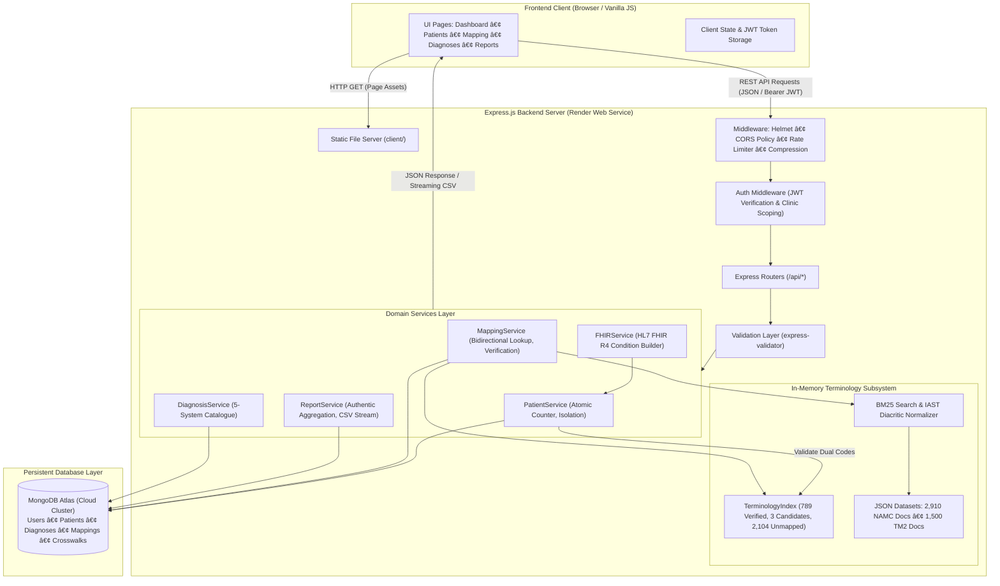

# CareSync — AYUSH and ICD-11 Diagnosis Connect

> Standardized clinical terminology crosswalk and dual-coding platform bridging traditional Indian medicine (AYUSH / NAMASTE) and the World Health Organization ICD-11 Traditional Medicine Module 2 (TM2).

[](https://nodejs.org/)
[](https://expressjs.com/)
[](https://www.mongodb.com/atlas)
[](https://hl7.org/fhir/R4/)
[-005A9C)](https://icd.who.int/en)
[](https://caresync-api-d59s.onrender.com)
[](server/test_production_readiness.js)

---

## 🔗 Quick Links & Live Deployment

| Resource | URL | Details |
|---|---|---|
| **Live Web Application** | [https://caresync-api-d59s.onrender.com](https://caresync-api-d59s.onrender.com/) | Deployed on Render Web Service (Monolithic Node.js Express server) |
| **API Health Check** | [https://caresync-api-d59s.onrender.com/api/health](https://caresync-api-d59s.onrender.com/api/health) | Returns JSON status, service name, and server timestamp |
| **GitHub Repository** | [https://github.com/sonuprasad100e-eng/Aayush-ICD-Connect](https://github.com/sonuprasad100e-eng/Aayush-ICD-Connect) | Source code repository (`main` branch) |

> [!NOTE]
> **Free Tier Cold Starts:** The live deployment is hosted on Render's free tier. If the application has not received traffic recently, the instance may spin down automatically. The first request after a period of inactivity may take **30 to 50 seconds** to boot. Subsequent requests will respond with standard latency.

> [!IMPORTANT]
> **Academic Prototype Notice:** CareSync is an academic engineering project and software research prototype. It is **not certified for real-world clinical decision-making or production patient data**. All demonstrations and tests should be conducted using synthetic, non-identifiable test records.

---

## Table of Contents

1. [Project Overview & Problem Statement](#1-project-overview--problem-statement)
2. [Objectives & Key Features](#2-objectives--key-features)
3. [AYUSH & ICD-11 Terminology Mapping Workflow](#3-ayush--icd-11-terminology-mapping-workflow)
4. [System Architecture](#4-system-architecture)
5. [Technology Stack](#5-technology-stack)
6. [Project Directory Structure](#6-project-directory-structure)
7. [Application Screenshots](#7-application-screenshots)
8. [Local Installation & Setup](#8-local-installation--setup)
9. [Environment Variable Configuration](#9-environment-variable-configuration)
10. [Running the Application Locally](#10-running-the-application-locally)
11. [Production Deployment on Render](#11-production-deployment-on-render)
12. [Terminology Data & Mapping Methodology](#12-terminology-data--mapping-methodology)
13. [API Documentation](#13-api-documentation)
14. [Reports & Analytics](#14-reports--analytics)
15. [Automated Testing & Verification](#15-automated-testing--verification)
16. [Security Considerations & Current Limitations](#16-security-considerations--current-limitations)
17. [Future Improvements & Roadmap](#17-future-improvements--roadmap)
18. [Contributing](#18-contributing)
19. [License](#19-license)
20. [Author & Acknowledgements](#20-author--acknowledgements)

---

## 1. Project Overview & Problem Statement

In clinical practice across India, traditional medical systems under the **AYUSH** umbrella (Ayurveda, Yoga & Naturopathy, Unani, Siddha, and Homeopathy) provide primary and specialized care to millions of individuals. However, diagnostic coding in traditional medicine has historically existed in isolation from modern healthcare IT systems, electronic health record (EHR) frameworks, and global morbidity reporting standards.

The Ministry of Ayush established the **NAMASTE** portal (National AYUSH Morbidity and Standardized Terminologies Electronic portal) and the **National Ayurveda Morbidity Codes (NAMC)** to provide structured diagnostic codes for Ayurvedic conditions. Simultaneously, the World Health Organization (WHO) introduced **Traditional Medicine Chapter 26 (Module 2 / TM2)** in **ICD-11**, establishing the first global diagnostic classification for traditional medicine concepts originating in ancient India.

### The Problem

Without an automated, standardized bridge between these systems:
* Traditional medicine diagnoses cannot be reliably communicated across modern hospital EHRs or international health registries.
* Dual-coding clinical records requires labor-intensive manual searches across disconnected PDFs and code compendia.
* Unverified or colloquial mappings risk clinical inaccuracies in patient documentation.
* Traditional medicine morbidity statistics cannot be seamlessly aggregated into national or global public health analytics.

### The CareSync Solution

**CareSync** provides an intelligent, full-stack web platform that connects traditional Indian medicine terminology with WHO ICD-11 TM2 terminology:
* **Dual-Coded Clinical Records:** Allows clinicians to document patient encounters using verified pairings of NAMASTE and ICD-11 TM2 codes simultaneously.
* **Bidirectional Terminology Lookup:** Enables instant resolution from a NAMC code to an ICD-11 TM2 code, or vice versa, supporting compound format codes (e.g., `SP51(EC-3)`).
* **BM25 Sanskrit-Aware Term Search:** Provides candidate retrieval tailored to Sanskrit disease names, IAST diacritics, and clinical synonyms.
* **Clinician Verification Governance:** Enforces a formal verification workflow where qualified clinicians certify candidate pairings before they can be used for clinical documentation.
* **Interoperable FHIR R4 Export:** Generates standard HL7 FHIR R4 `Condition` JSON resources containing dual-coded terminology representations.
* **Clinic-Level Multi-Tenancy:** Ensures patient and diagnostic records remain securely partitioned by clinical facility.

---

## 2. Objectives & Key Features

### Primary Objectives

1. **Standardize Dual-Coding:** Provide an intuitive interface for clinicians to document traditional diagnoses alongside recognized international diagnostic codes.
2. **Prevent Clinical Mapping Errors:** Gating patient registration to strictly enforce that only officially verified terminology crosswalks can be saved to patient records.
3. **Enhance Interoperability:** Export patient diagnostic data in HL7 FHIR Release 4 standard JSON format.
4. **Ensure Production Reliability:** Build a secure, production-hardened platform deployed on cloud infrastructure (Render + MongoDB Atlas).

### Implemented Features

* **Patient Management & Registry:**
  * Full demographic capture, clinical status tagging (`stable`, `critical`, `review`), and soft-deletion.
  * Automated atomic patient code generation (`P001`, `P002`, ...) using a dedicated MongoDB Counter model preventing race conditions under concurrent requests.
  * Strict crosswalk validation: patient encounters cannot be saved with unverified or mismatched terminology pairs.
  * Clinic-scoped multi-tenancy: clinics only view and mutate their own patient records.

* **AYUSH / NAMASTE & ICD-11 TM2 Terminology Lookup:**
  * Exact and parenthetical code lookup supporting canonical compound codes (e.g., `SP51(EC-3)`), bare morbidity codes (e.g., `EC-3`), and standard prefixes (`AYU-`, `SR11`).
  * Case-insensitive and whitespace-normalized query resolution.
  * Symmetric reverse lookup: resolving from either direction yields paired code, disorder titles, and relationship evidence.

* **BM25 Sanskrit & Synonym Retrieval:**
  * Custom Okapi BM25 ranking algorithm supporting IAST Sanskrit diacritic normalization (`ā` → `a`, `ś` → `s`, `ḥ` → `h`, etc.) and Sanskrit terminal visarga handling.
  * In-memory indexing of 2,910 NAMC documents and 1,500 WHO ICD-11 TM2 concepts.

* **Crosswalk Management & Clinical Verification:**
  * Strict partitioning between **verified crosswalks** (certified pairings) and **unverified candidates** (algorithmic suggestions requiring review).
  * Doctor-level verification interface supporting relationship types (`equivalent`, `broader`, `narrower`, `related`) and WHO Entity URI specification.
  * Conflict detection: rejects attempts to assign conflicting or duplicate pairings.
  * Real-time synchronization between global terminology crosswalks and clinic mapping histories.

* **Standardized Diagnoses Library:**
  * Browsable catalog across 5 AYUSH streams: Ayurveda, Yoga & Naturopathy, Unani, Siddha, and Homeopathy.
  * Live filtering by disorder name, subtitle, or clinical code.
  * Visual indicators showing dual-coding completeness and FHIR export capability.

* **Reports & Analytics:**
  * Authentic clinic metrics: actual active patient count, unique diagnostic concepts, and total catalogue size.
  * Morbidity distribution chart showing patient volume across AYUSH medical streams.
  * 6-month dual-coding volume trend chart based on genuine encounter timestamps.
  * Honest empty-state indicators: unavailable integrations (e.g. insurance claims) display an explicit pending state rather than fabricated rates.

* **Streaming CSV Exports:**
  * Server-side streaming CSV export of clinic morbidity records (`/api/reports/export`).
  * Downloadable audit logs of confirmed terminology mappings (`/api/reports/download/:id`).
  * Multipart batch CSV upload to queue terms for automated dual-coding (`/api/mapping/bulk-upload`).

* **FHIR R4 Condition Export:**
  * Dynamic generation of standard HL7 FHIR Release 4 `Condition` JSON resources for any registered patient.
  * Includes dual-coded representations with official code system URIs (`https://namstp.ayush.gov.in/#/namaste` and `http://id.who.int/icd/release/11/mms`).
  * In-browser JSON inspector with one-click copy-to-clipboard functionality.

* **Production-Hardened Security:**
  * Mandatory high-entropy `JWT_SECRET` validation (rejects empty, short, or placeholder secrets in production).
  * Strict production database connection policy (no silent in-memory fallback if Atlas connection fails).
  * Automatic demo account seeding guard (prevents creation of accounts with `password123` in production).
  * Origin-restricted CORS delegate supporting same-host deployment on Render and configured `CLIENT_URL` domains.

### Planned Features (Future Roadmap)

* Live ABDM (Ayushman Bharat Digital Mission) gateway integration for production ABHA OTP verification.
* Direct real-time synchronization with the official WHO ICD-11 API using OAuth 2.0 client credentials.
* Dense vector semantic search (BioBERT / clinical embeddings) to complement sparse BM25 retrieval.
* Expansion of verified crosswalk datasets to Unani, Siddha, and Homeopathy national morbidity codes.
* Integration with insurance claims clearinghouses for automated claim filing with dual-coded diagnostics.

---

## 3. AYUSH & ICD-11 Terminology Mapping Workflow

The core technical challenge addressed by CareSync is aligning clinical concepts from traditional Indian medicine with the WHO ICD-11 classification.

```text
┌──────────────────────────────┐          ┌──────────────────────────────┐
│   National Ayurveda          │          │   WHO ICD-11 Chapter 26      │
│   Morbidity Codes (NAMC)     │          │   Traditional Medicine (TM2) │
│   e.g. Jvara (EC-3)          │          │   e.g. Fever disorder (SP51) │
└──────────────┬───────────────┘          └──────────────┬───────────────┘
               │                                         │
               └───────────────────┬─────────────────────┘
                                   â–¼
                 ┌────────────────────────────────────┐
                 │       CareSync Terminology Engine   │
                 │   • 789 Verified Crosswalks        │
                 │   • 3 Unverified Candidates        │
                 │   • 2,104 Unmapped NAMC Concepts   │
                 └─────────────────┬──────────────────┘
                                   │
         ┌─────────────────────────┴─────────────────────────┐
         â–¼                                                   â–¼
┌─────────────────────────────────┐         ┌─────────────────────────────────┐
│     Verified Crosswalk Match    │         │     Unverified / Candidate      │
│  • Direct bidirectional lookup  │         │  • Gated by Doctor Verification │
│  • Immediate patient registry   │         │  • Relationship: broader, etc.  │
│  • Generates HL7 FHIR R4 JSON   │         │  • Blocked from Patient Save    │
└─────────────────────────────────┘         └─────────────────────────────────┘
```

1. **Exact Code Lookup:** Entering either a NAMC code (e.g. `SP51(EC-3)` or `EC-3`) or an ICD-11 TM2 code (e.g. `SP51`) resolves via `TerminologyIndex` in O(1) time.
2. **Free-Text Search:** Entering terms like `"fever"`, `"jvara"`, or `"jvaraḥ"` triggers the BM25 retrieval engine, searching across both NAMC and WHO concept corpora with IAST diacritic normalization.
3. **Verification Gating:** If a pairing is verified (`verified: true`), it is immediately available for patient registration. If a pairing is a candidate (`verified: false`), the patient registration API returns HTTP 400 Bad Request, instructing the doctor to certify the mapping in the Disease Mapping module first.
4. **Clinical Governance:** Clinicians assign relationship types (`equivalent`, `broader`, `narrower`, `related`) and record WHO Entity URIs, establishing an audit trail.

---

## 4. System Architecture

CareSync is built as a unified client-server web application. The Express backend serves both the RESTful API endpoints and the static frontend assets from a single deployment service.



---

## 5. Technology Stack

### Frontend (`client/`)

| Technology | Purpose |
|---|---|
| **HTML5 & CSS3** | Semantic markup and responsive grid layouts |
| **Vanilla JavaScript (ES6+)** | Frontend application logic, DOM manipulation, and REST API communication |
| **Custom CSS Design System** | Glassmorphic cards, CSS design tokens, and persistent Dark / Light theme switching |
| **Bootstrap 5.3 (CDN)** | Layout utilities and accessible modal dialogs |
| **Chart.js 4.4 (CDN)** | Interactive data visualizations (morbidity breakdown and monthly volume trends) |
| **Font Awesome 6 (CDN)** | Clinical, diagnostic, and interface iconography |

### Backend API (`server/`)

| Technology | Purpose |
|---|---|
| **Node.js (v18+)** | Asynchronous JavaScript runtime environment |
| **Express.js (4.19)** | RESTful API framework, middleware pipeline, and static frontend hosting |
| **Mongoose (8.5)** | Object Data Modeling (ODM) for MongoDB with schema validation and indexing |
| **jsonwebtoken (9.0)** | Stateless authentication with cryptographically signed JWT tokens |
| **bcryptjs (2.4)** | Password hashing using salted bcrypt (cost factor 12) |
| **express-validator (7.1)**| Input validation and sanitization for request payloads |
| **helmet (7.1)** | Security HTTP headers |
| **cors (2.8)** | Dynamic origin-restricted Cross-Origin Resource Sharing middleware |
| **express-rate-limit (7.3)**| Request throttling on sensitive endpoints (e.g. `/api/auth/login`) |
| **compression (1.7)** | Gzip response compression |
| **morgan (1.10)** | HTTP request logging for development environments |
| **multer (1.4)** | Multipart form data handling for batch CSV uploads and profile photos |
| **xlsx (0.18)** | Server-side Excel parsing for National Ayurveda Morbidity Codes ingestion |

### Database & Terminology Processing

| Technology | Purpose |
|---|---|
| **MongoDB Atlas** | Primary persistent document database in production |
| **mongodb-memory-server (9.2)** | Zero-configuration ephemeral in-memory database fallback for local dev & testing |
| **Okapi BM25 Ranking** | In-memory Information Retrieval algorithm for Sanskrit medical concepts |
| **IAST Diacritic Normalizer** | Unicode diacritic folding (`ā, ī, ū, ṛ, ṝ, ḷ, ḹ, ṅ, ñ, ṭ, ḍ, ṇ, ś, ṣ, ḥ, ṃ`) |

---

## 6. Project Directory Structure

```text
Aayush-ICD-Connect/
├── client/                               # Frontend user interface (Served by Express)
│   ├── index.html                        # Authentication portal & ABHA login
│   ├── dashboard.html                    # Clinical dashboard and summary KPIs
│   ├── patients.html                     # Patient management and FHIR inspector
│   ├── mapping.html                      # Disease mapping and terminology lookup
│   ├── diagnoses.html                    # 5-system AYUSH diagnoses library
│   ├── reports.html                      # Morbidity analytics and CSV exports
│   ├── settings.html                     # User profile, preferences, and security
│   ├── script.js                         # Dynamic frontend application logic (122 KB)
│   └── style.css                         # Unified responsive styling and theme tokens (80 KB)
│
├── server/                               # Node.js backend server and data processing
│   ├── package.json                      # Server scripts and dependency manifest
│   ├── package-lock.json                 # Pinned dependency lockfile
│   ├── .env.example                      # Configuration template with placeholders
│   │
│   ├── data/                             # Raw and processed terminology datasets
│   │   ├── mappings/
│   │   │   └── namaste_icd11_tm2_crosswalk.json  # Baseline crosswalk seed (9 records)
│   │   └── rag/
│   │       ├── namc/
│   │       │   └── NATIONAL AYURVEDA MORBIDITY CODES_2.xlsx  # Official NAMC source
│   │       └── processed/
│   │           ├── namc_documents.json           # 2,910 processed Ayurveda documents
│   │           └── icd11_tm2_documents.json      # 1,500 WHO TM2 concepts
│   │
│   ├── src/                              # Backend application source code
│   │   ├── server.js                     # HTTP server startup and graceful shutdown
│   │   ├── app.js                        # Express app, middleware, and route mounting
│   │   │
│   │   ├── config/                       # Configuration modules
│   │   │   ├── db.js                     # MongoDB connection with in-memory fallback
│   │   │   ├── env.js                    # Environment variable loader & JWT validator
│   │   │   └── uploads.js                # Multer upload storage configurations
│   │   │
│   │   ├── controllers/                  # Route handlers
│   │   │   ├── authController.js         # Login, registration, password management
│   │   │   ├── dashboardController.js    # Dashboard summary aggregations
│   │   │   ├── diagnosisController.js    # Diagnosis catalogue management
│   │   │   ├── mappingController.js      # Terminology lookup, search, verification
│   │   │   ├── notificationController.js # Notifications and read status
│   │   │   ├── patientController.js      # Patient CRUD, validation, and FHIR export
│   │   │   ├── publicController.js       # Public system statistics
│   │   │   ├── reportController.js       # Authentic reports and streaming CSV exports
│   │   │   └── settingsController.js     # User profile and clinical preferences
│   │   │
│   │   ├── middleware/                   # Express middleware
│   │   │   ├── auth.js                   # JWT verification and RBAC enforcement
│   │   │   ├── errorHandler.js           # Centralized JSON error response handler
│   │   │   └── validate.js               # express-validator result handler
│   │   │
│   │   ├── models/                       # Mongoose data schemas (12 models)
│   │   │   ├── AnalyticsSnapshot.js      # Historical report snapshots
│   │   │   ├── AuditLog.js               # Clinical mutation audit trail
│   │   │   ├── Clinic.js                 # Clinic multi-tenancy organization
│   │   │   ├── Counter.js                # Atomic sequential ID counter
│   │   │   ├── Diagnosis.js              # Standardized catalogue entries
│   │   │   ├── Mapping.js                # Clinic-confirmed mapping records
│   │   │   ├── MappingEvidence.js        # Algorithmic candidate evidence
│   │   │   ├── Notification.js           # In-app notifications
│   │   │   ├── Patient.js                # Patient demographics and dual codes
│   │   │   ├── Report.js                 # Exported report file metadata
│   │   │   ├── TerminologyCrosswalk.js   # Authoritative verified crosswalks
│   │   │   └── User.js                   # User credentials, roles, and profiles
│   │   │
│   │   ├── rag/                          # Information retrieval subsystem
│   │   │   ├── ingestion/                # Excel and JSON data parser utilities
│   │   │   └── retrieval/
│   │   │       └── bm25.js               # BM25 engine with Sanskrit normalizer
│   │   │
│   │   ├── routes/                       # Express router definitions
│   │   │   ├── authRoutes.js             # /api/auth routes
│   │   │   ├── dashboardRoutes.js        # /api/dashboard routes
│   │   │   ├── diagnosisRoutes.js        # /api/diagnoses routes
│   │   │   ├── mappingRoutes.js          # /api/mapping routes
│   │   │   ├── notificationRoutes.js     # /api/notifications routes
│   │   │   ├── patientRoutes.js          # /api/patients routes
│   │   │   ├── publicRoutes.js           # /api/public routes
│   │   │   ├── reportRoutes.js           # /api/reports routes
│   │   │   └── settingsRoutes.js         # /api/settings routes
│   │   │
│   │   ├── seed/                         # Database seeding
│   │   │   └── seedDemoData.js           # Idempotent crosswalk & demo seeder
│   │   │
│   │   └── services/                     # Business logic and domain services
│   │       ├── auditService.js           # Mutation auditing
│   │       ├── authService.js            # Password hashing, JWT signing
│   │       ├── dashboardService.js       # Live metrics calculation
│   │       ├── diagnosisService.js       # Catalogue queries
│   │       ├── fhirService.js            # HL7 FHIR R4 Condition resource builder
│   │       ├── mappingService.js         # Bidirectional resolution and verification
│   │       ├── notificationService.js    # System alerts
│   │       ├── patientService.js         # Atomic P001-series patient registration
│   │       ├── publicService.js          # Anonymous statistics
│   │       ├── reportService.js          # Authentic metrics, CSV streaming
│   │       ├── settingsService.js        # Profile and preference updates
│   │       └── terminologyIndex.js       # 2,910-record in-memory crosswalk index
│   │
│   ├── test_production_readiness.js      # Production safety, JWT, DB, and CORS tests
│   ├── test_reports_trustworthy_analytics.js  # Reports and authentic analytics tests
│   ├── test_phase2b_crosswalk_seeding.js # Crosswalk seeding & patient gating tests
│   ├── test_phase2c_mapping_sync.js      # Mapping verification & dashboard sync tests
│   ├── test_patient_id_generation.js     # Atomic patient ID concurrency tests
│   ├── test_automatic_terminology_lookup.js # Bidirectional lookup tests
│   ├── test_comprehensive_terminology_index.js # Terminology index & format tests
│   └── test_functionality_audit.js       # End-to-end integration audit
│
└── README.md                             # Comprehensive project documentation
```

---

## 7. Application Screenshots

*Visual interface captures can be added to the repository in `docs/screenshots/`.*

To add screenshots to your repository fork:
1. Capture screenshots of key views:
   * **Dashboard:** Summary metrics and triage feed
   * **Patients:** Patient registry, status badges, and multi-tab detail view
   * **Disease Mapping:** Terminology code lookup and Sanskrit BM25 search
   * **Diagnoses:** 5-system AYUSH catalogue with filtering
   * **Reports:** Morbidity breakdown and monthly volume trends
   * **FHIR Inspector:** HL7 FHIR R4 `Condition` JSON modal
2. Place the images in a `docs/screenshots/` directory.
3. Link them in Markdown: ``.

---

## 8. Local Installation & Setup

### Prerequisites

* **Node.js:** v18.0.0 or higher (minimum supported: v16.14.0).
* **npm:** v9.0.0 or higher.
* **Modern Web Browser:** Chrome, Edge, Firefox, or Safari.
* **MongoDB (Optional for local testing):** If no MongoDB URI is provided, CareSync automatically launches an in-memory database (`mongodb-memory-server`) with zero setup!

### Step 1: Clone the Repository

```bash
git clone https://github.com/sonuprasad100e-eng/Aayush-ICD-Connect.git
cd Aayush-ICD-Connect
```

### Step 2: Install Dependencies

Navigate to the `server/` directory and install the required npm packages:

```bash
cd server
npm install
```

### Step 3: Configure Environment Variables

Create your local `.env` file from the example template:

```bash
cp .env.example .env
```

*For quick local evaluation, you can leave `.env` empty or omit it entirely. CareSync will automatically use development defaults and run on the embedded in-memory database.*

---

## 9. Environment Variable Configuration

All environment variables are configured in `server/.env`. The application reads them via `dotenv`.

| Variable | Required in Production? | Default (Development) | Purpose & Usage |
|---|---|---|---|
| `PORT` | Optional | `8000` | HTTP port on which the Express server listens. Render sets this dynamically. |
| `NODE_ENV` | **Required** | `development` | Set to `production` in production. Disables dev logging, disables demo accounts, and enforces strict security checks. |
| `CLIENT_URL` | Optional | `http://localhost:8000` | Allowed frontend origin URL(s) for CORS. Can be a comma-separated list of domains. |
| `MONGODB_URI` | **Required in Prod** | `""` (In-memory fallback) | MongoDB Atlas connection string. In production, an empty or unreachable URI aborts startup immediately. |
| `JWT_SECRET` | **Required in Prod** | Development fallback | Secret key for signing and verifying JWT tokens. In production, must be at least 32 characters and cannot be a default placeholder. |
| `ICD_API_CLIENT_ID` | Optional | `""` | Client ID for official WHO ICD-11 API (`https://icd.who.int/icdapi`). |
| `ICD_API_CLIENT_SECRET` | Optional | `""` | Client Secret for official WHO ICD-11 API. |

### Sample Local `.env` Template

```env
# Server Runtime
PORT=8000
NODE_ENV=development
CLIENT_URL=http://localhost:8000

# Database (Leave empty for automatic in-memory MongoDB during local testing)
# MONGODB_URI=mongodb+srv://<username>:<password>@<cluster>.mongodb.net/<database>?retryWrites=true&w=majority
MONGODB_URI=

# JWT Authentication Secret
JWT_SECRET=your_jwt_secret_key_change_in_production

# Optional: WHO ICD-11 API Client Credentials
ICD_API_CLIENT_ID=
ICD_API_CLIENT_SECRET=
```

> **Security Warning:** Never commit `.env` containing sensitive credentials or production JWT secrets to Git. The `.gitignore` file is configured to exclude all `.env` files.

---

## 10. Running the Application Locally

### Starting the Server

From the `server/` directory:

```bash
# Production mode or standard start
npm start

# Development mode with automatic file watching and restart
npm run dev
```

### Seeding Demo Data (Local Development Only)

To populate the local or test database with sample clinics, demo patients, and catalogue entries:

```bash
npm run seed
```

### Accessing the Web Application

Open your browser and navigate to:

```text
http://localhost:8000
```

The Express server serves the static frontend client from `client/` at the root path.

### Default Local Demonstration Accounts

When running with local seeded demo data:

| Clinic | Role | Email / Identifier | Password | ABHA ID |
|---|---|---|---|---|
| **Patanjali Ayush Kendra** | Doctor | `sonu@caresync.in` *(or `doctor@caresync.in`)* | `password123` | `12-3456-7890-1234` |
| **National Homeopathy Clinic** | Doctor | `dr.sharma@ayushcare.in` | `password123` | `98-7654-3210-9876` |

*In production (`NODE_ENV=production`), automatic creation of these accounts is completely disabled for security. New clinics register directly via the signup form.*

---

## 11. Production Deployment on Render

CareSync is deployed on **Render** as a monolithic Web Service where Express simultaneously exposes the REST API and serves the `client/` static frontend.

### Live Production Configuration

* **Live URL:** [https://caresync-api-d59s.onrender.com](https://caresync-api-d59s.onrender.com/)
* **Health Check URL:** [https://caresync-api-d59s.onrender.com/api/health](https://caresync-api-d59s.onrender.com/api/health)
* **Hosting Platform:** Render Web Service
* **Git Branch:** `main`
* **Root Directory:** `server`
* **Build Command:** `npm install`
* **Start Command:** `npm start`
* **Database:** MongoDB Atlas (Cloud Replica Set)

### Step-by-Step Render Deployment Instructions

1. **Create a MongoDB Atlas Cluster:**
   * Create a free M0 cluster on MongoDB Atlas.
   * Under **Database Access**, create a database user with read/write permissions.
   * Under **Network Access**, add `0.0.0.0/0` (allow access from anywhere) so Render instances can connect.
   * Copy the connection string (e.g. `mongodb+srv://<user>:<password>@cluster.mongodb.net/caresync?retryWrites=true&w=majority`).

2. **Generate a Secure JWT Secret:**
   * Run the following command in your terminal to generate a secure 384-bit random key:
     ```bash
     node -e "console.log(require('crypto').randomBytes(48).toString('hex'))"
     ```

3. **Create the Web Service on Render:**
   * Log in to the [Render Dashboard](https://dashboard.render.com/) and click **New → Web Service**.
   * Connect your GitHub repository: `https://github.com/sonuprasad100e-eng/Aayush-ICD-Connect`.
   * Configure the service settings:
     * **Name:** `caresync-api` (or your preferred name)
     * **Region:** Oregon (US West) or closest to your database
     * **Branch:** `main`
     * **Root Directory:** `server`
     * **Runtime:** `Node`
     * **Build Command:** `npm install`
     * **Start Command:** `npm start`
     * **Instance Type:** `Free`

4. **Set Environment Variables on Render:**
   Under the **Environment** tab of your Render service, add:
   * `NODE_ENV` = `production`
   * `MONGODB_URI` = `mongodb+srv://<user>:<password>@cluster.mongodb.net/caresync?retryWrites=true&w=majority`
   * `JWT_SECRET` = `<your-generated-48-byte-hex-string>`
   * `CLIENT_URL` = `https://caresync-api-d59s.onrender.com`

5. **Deploy & Verify:**
   * Click **Create Web Service**.
   * Render will clone the repository, install dependencies, and start the server using `npm start`.
   * Once live, verify the deployment:
     ```bash
     curl -i https://caresync-api-d59s.onrender.com/api/health
     ```
   * The response should return HTTP 200 with `status: "ok"`.

---

## 12. Terminology Data & Mapping Methodology

CareSync relies on verified, curated terminology datasets located in `server/data/`:

### Datasets in the Repository

1. **National Ayurveda Morbidity Codes (NAMC):**
   * Sourced from the official Ministry of Ayush publication (`NATIONAL AYURVEDA MORBIDITY CODES_2.xlsx`).
   * Contains exactly **2,910** structured Ayurveda morbidity concepts stored in `server/data/rag/processed/namc_documents.json`.
   * Fields include Morbidity Code (e.g. `EC-3`, `AAA-1`, `AAC-35`), Sanskrit term (e.g. `jvaraH`, `vAtasa~jcayaH`, `viSvAcI`), English diagnosis, and disease category.

2. **WHO ICD-11 Traditional Medicine Module 2 (TM2):**
   * Sourced from the WHO ICD-11 Foundation and MMS release for Chapter 26 (Traditional Medicine Module 2).
   * Contains exactly **1,500** concepts stored in `server/data/rag/processed/icd11_tm2_documents.json`.
   * Fields include Foundation Entity URI, assigned alphanumeric TM2 code (e.g. `SP51`, `SR11`, `SK51`), concept title, parent hierarchy classifications, and international synonyms.

### In-Memory Terminology Index (`terminologyIndex.js`)

The server initializes an in-memory `TerminologyIndex` on startup containing:
* **789 Verified Mappings:** Concept pairings verified through authoritative dual-coded Morbidity Codes (e.g. `SP51(EC-3)` mapping to WHO TM2 code `SP51` and NAMC code `EC-3`).
* **3 Unverified Candidate Mappings:** Algorithmic proposals pending clinician certification (e.g. `AYU-0205` ↔ `SP80`).
* **2,104 Unmapped NAMC Concepts:** Official Ayurveda concepts from the catalogue that do not yet have an authoritative ICD-11 TM2 counterpart.
* **400 Unique WHO TM2 Codes:** Represented across the verified pairings.

### Clinical Relationship Types

Diagnoses originating in different clinical traditions do not always exhibit identical 1-to-1 equivalence. CareSync records relationship types during clinician verification:

| Relationship Type | Clinical Meaning | Verified Example |
|---|---|---|
| `equivalent` | Clinical concepts align in diagnostic scope and etiology | *Jvara (Ayurveda)* ↔ *Fever disorder (TM2)* |
| `broader` | The traditional medicine term encompasses a wider diagnostic spectrum | *Amavata* mapped to a specific inflammatory joint entity |
| `narrower` | The traditional medicine term represents a specific sub-type | A specific sub-dosha variant mapped to a broader category |
| `related` | Concepts share symptomatic or pathological overlap without identity | Functional syndrome comparisons |

---

## 13. API Documentation

All API endpoints are prefixed with `/api` and return standardized JSON responses. Protected routes require a valid Bearer token in the `Authorization` header: `Authorization: Bearer <token>`.

### Authentication Endpoints (`/api/auth`)

| Method | Endpoint | Description | Auth Required |
|---|---|---|---|
| `POST` | `/api/auth/login` | Doctor / Administrator login via email or ABHA ID (rate limited) | No |
| `POST` | `/api/auth/register` | Register a new clinic facility and doctor account | No |
| `POST` | `/api/auth/abha-auth` | Simulated ABHA login gateway (returns 501 for security) | No |
| `POST` | `/api/auth/forgot-password` | Initiate password recovery workflow | No |
| `GET` | `/api/auth/me` | Retrieve profile of the currently logged-in user | Yes |
| `POST` | `/api/auth/logout` | Invalidate current user session | Yes |
| `POST` | `/api/auth/change-password` | Update account password (requires current password) | Yes |

### Patient Management Endpoints (`/api/patients`)

| Method | Endpoint | Description | Auth Required |
|---|---|---|---|
| `GET` | `/api/patients` | Search, filter, and paginate clinic patient records | Yes |
| `POST` | `/api/patients` | Register a new patient with dual codes (validates verified crosswalk) | Yes |
| `GET` | `/api/patients/:id` | Retrieve full patient record by ID | Yes |
| `PUT` | `/api/patients/:id` | Update patient demographics or clinical status (`stable`, `critical`, `review`) | Yes |
| `DELETE` | `/api/patients/:id` | Soft-delete a patient record | Yes |
| `GET` | `/api/patients/:id/fhir` | Generate and export standard HL7 FHIR R4 `Condition` JSON resource | Yes |

### Disease Mapping and Terminology Endpoints (`/api/mapping`)

| Method | Endpoint | Description | Auth Required |
|---|---|---|---|
| `GET` | `/api/mapping/lookup` | Bidirectional lookup by code (`?code=SP51` or `?code=EC-3`) | Yes |
| `GET` | `/api/mapping/search` | Term search with confidence scoring and IAST diacritic folding | Yes |
| `GET` | `/api/mapping/candidates` | Retrieve candidate matches using the BM25 retrieval engine | Yes |
| `POST` | `/api/mapping/verify` | Certify clinical candidate equivalence and record WHO Entity URI | Yes (Doctor) |
| `POST` | `/api/mapping/verify-official-code` | Verify WHO entity with official alphanumeric code | Yes (Doctor) |
| `POST` | `/api/mapping/confirm` | Confirm and record a dual-coding mapping in clinic history | Yes |
| `GET` | `/api/mapping/recent` | List recently confirmed mappings for the clinic | Yes |
| `GET` | `/api/mapping/stats` | Mapping accuracy, volume, and verification statistics | Yes |
| `POST` | `/api/mapping/bulk-upload` | Upload CSV batch file for terminology dual-coding | Yes |

### Diagnoses Catalogue Endpoints (`/api/diagnoses`)

| Method | Endpoint | Description | Auth Required |
|---|---|---|---|
| `GET` | `/api/diagnoses` | Filter diagnoses by AYUSH system (`ayurveda`, `yoga`, `unani`, `siddha`, `homeopathy`) | Yes |
| `POST` | `/api/diagnoses` | Add a new standardized catalogue entry | Yes |
| `GET` | `/api/diagnoses/:id` | Retrieve single diagnosis catalogue record | Yes |
| `PUT` | `/api/diagnoses/:id` | Update catalogue diagnosis details | Yes |
| `DELETE` | `/api/diagnoses/:id` | Remove diagnosis from catalogue | Yes |

### Reports and Analytics Endpoints (`/api/reports`)

| Method | Endpoint | Description | Auth Required |
|---|---|---|---|
| `GET` | `/api/reports/overview` | Authentic clinic overview KPIs (patients, unique concepts, catalogue size) | Yes |
| `GET` | `/api/reports/system-breakdown` | Patient distribution across AYUSH medical systems | Yes |
| `GET` | `/api/reports/trend` | Chronological monthly dual-coding volume trend series | Yes |
| `GET` | `/api/reports/files` | List authentic downloadable report files | Yes |
| `GET` | `/api/reports/export` | Stream live clinic morbidity encounters as a standard CSV file | Yes |
| `GET` | `/api/reports/download/:id` | Download a specific pre-generated audit report file | Yes |

### User Settings and Notifications Endpoints (`/api/settings`, `/api/notifications`)

| Method | Endpoint | Description | Auth Required |
|---|---|---|---|
| `GET` | `/api/settings` | Retrieve user preferences, clinic details, and security settings | Yes |
| `PUT` | `/api/settings/profile` | Update profile information | Yes |
| `POST` | `/api/settings/photo` | Upload user profile avatar (Multipart) | Yes |
| `PUT` | `/api/settings/security` | Update account security preferences | Yes |
| `PUT` | `/api/settings/preferences` | Update clinical preferences (default system, language, dark mode) | Yes |
| `PUT` | `/api/settings/notifications` | Update notification triggers | Yes |
| `GET` | `/api/notifications` | Retrieve clinic notifications and unread counter | Yes |
| `PUT` | `/api/notifications/read-all` | Mark all notifications as read | Yes |
| `PUT` | `/api/notifications/:id/read` | Mark a specific notification as read | Yes |

### Public and Health Endpoints

| Method | Endpoint | Description | Auth Required |
|---|---|---|---|
| `GET` | `/api/health` | Backend service health check | No |
| `GET` | `/api/public/stats` | Anonymous platform summary statistics | No |

---

## 14. Reports & Analytics

CareSync aggregates operational metrics strictly from authentic database encounters:

* **Total Diagnoses (2,910):** Sourced directly from the official processed NAMC dataset.
* **Active Clinic Cases:** Sourced from `Patient.countDocuments({ clinicId, isDeleted: false })`.
* **Unique Concepts:** Grouped distinct `namasteCode` values registered in the clinic.
* **System Breakdown:** Calculated from registered patients in the clinic.
* **Monthly Trend:** Groups confirmed patient encounters into 6 chronological monthly buckets using genuine database timestamps.
* **Insurance Claims Status:** Because no insurance claims adjudication clearinghouse is connected, the API honestly returns `claims.available: false` and `null` rates. No fabricated statistics are generated.

---

## 15. Automated Testing & Verification

CareSync includes comprehensive, isolated regression and integration test suites. Tests run against an ephemeral in-memory MongoDB instance without modifying production or persistent database records.

### Verified Test Suites & Actual Results

| Test Script | Tested Scope | Assertions Passed |
|---|---|---|
| `test_production_readiness.js` | Production safety: JWT secret validation, DB fallback rejection, demo seeding guard, CORS policy | **17 / 17 passed** |
| `test_comprehensive_terminology_index.js` | 2,910 NAMC docs, 1,500 TM2 docs, 789 verified index, bidirectional lookup, diacritic search | **61 / 61 passed** |
| `test_automatic_terminology_lookup.js` | Symmetric NAMC ↔ ICD-11 lookup, whitespace/case normalization, canonical compound codes | **68 / 68 passed** |
| `test_reports_trustworthy_analytics.js` | Zero-fabricated defaults, authentic patient aggregation, clinic isolation, honest claims state | **46 / 46 passed** |
| `test_phase2c_mapping_sync.js` | Clinician verification flow, crosswalk synchronization, dashboard stats, duplicate rejection | **64 / 64 passed** |
| `test_phase2b_crosswalk_seeding.js` | Idempotent crosswalk seeding, 6 verified + 3 candidate partitioning, patient registration gating | **56 / 56 passed** |
| `test_patient_id_generation.js` | Atomic sequential patient IDs (`P001`), 10 parallel concurrent requests, restart persistence | **39 / 39 passed** |
| `test_verify_official_code.js` | RBAC doctor verification, official WHO entity code entry, conflicting pairing rejection | **21 / 21 passed** |
| `test_functionality_audit.js` | End-to-end integration audit covering Auth, ABHA fallback, Notifications, and CSV exports | **7 / 7 passed** |

### Running the Test Suites

From the `server/` directory, execute any test suite using Node.js:

```bash
cd server

# Run the production readiness and deployment safety test suite (17 tests)
node test_production_readiness.js

# Run the comprehensive terminology index test suite (61 tests)
node test_comprehensive_terminology_index.js

# Run the automatic terminology lookup test suite (68 tests)
node test_automatic_terminology_lookup.js

# Run the trustworthy analytics test suite (46 tests)
node test_reports_trustworthy_analytics.js

# Run the atomic patient ID generation concurrency test suite (39 tests)
node test_patient_id_generation.js

# Run the complete functionality audit test suite (7 tests)
node test_functionality_audit.js
```

---

## 16. Security Considerations & Current Limitations

### Implemented Security Measures

1. **Environment Protection:**
   * Secret keys and connection strings reside exclusively in `server/.env`.
   * Sample configurations are provided via `.env.example` using placeholder values.
   * `.gitignore` ensures environment files and uploaded assets are not committed to Git.
2. **Clinic-Level Multi-Tenancy:**
   * All patient encounters, diagnosis records, and mapping confirmations are indexed with a `clinicId`.
   * Requests are authenticated via JWT, and controllers strictly filter database queries by the authenticated user's clinic ID.
   * Cross-clinic mutations are rejected with HTTP 403 Forbidden.
3. **Authentication & Cryptography:**
   * Passwords are encrypted using `bcryptjs` with a work factor of 12 before persistence.
   * Stateless authentication using signed JSON Web Tokens (JWT) with standard expiry.
   * Sensitive endpoints (such as `/api/auth/login`) are protected with `express-rate-limit` to prevent brute-force attacks.
4. **Input Validation and Sanitization:**
   * Incoming request bodies and query parameters are validated using `express-validator`.
   * Dangerous characters and potential script injections are sanitized before database storage.
5. **CORS Protection:**
   * In production, unauthorized external cross-origin requests are rejected with status 403, preventing unauthorized third-party sites from invoking APIs with user credentials.

### Current Limitations

* **Simulated ABHA Authentication:** The current ABHA login endpoint operates in simulation mode. Direct passwordless login is disabled (returns HTTP 501) pending official ABDM Gateway credentials and SMS OTP verification.
* **Ayurveda-Centric Verified Crosswalks:** While the diagnosis catalogue supports all 5 AYUSH systems, the automated bidirectional terminology index currently features verified crosswalks primarily between Ayurveda NAMC and ICD-11 TM2. Unani, Siddha, and Homeopathy national codes are not yet fully indexed.
* **Insurance Claims Processing:** No live insurance clearinghouse or claims adjudication gateway is connected. Claims KPIs display an honest unavailable state.
* **FHIR R4 Scope:** The FHIR utility dynamically builds HL7 FHIR R4 `Condition` resources for individual encounters, but CareSync does not operate as a standalone FHIR server (e.g., HAPI FHIR) supporting full FHIR search parameters.

---

## 17. Future Improvements & Roadmap

* **ABDM M1, M2, and M3 Certification:** Integration with production Ayushman Bharat Digital Mission gateways for patient discovery, health record linking, and consent management.
* **WHO ICD-11 API Live Sync:** Utilizing official client credentials (`ICD_API_CLIENT_ID` / `ICD_API_CLIENT_SECRET`) to query the WHO API directly for real-time ICD-11 release updates.
* **Dense Vector Search:** Augmenting sparse BM25 retrieval with dense embedding models (BioBERT, clinical embeddings) to capture broader semantic nuances.
* **Expansion across AYUSH Systems:** Ingestion and mapping of Unani, Siddha, and Homeopathy national morbidity codes.
* **Mobile / PWA Offline Support:** Adding progressive web app capabilities for offline patient triage in rural or low-connectivity clinic environments.

---

## 18. Contributing

Contributions, bug reports, and suggestions are welcome. To contribute:

1. **Fork the Repository:** Create a personal fork on GitHub.
2. **Create a Feature Branch:**
   ```bash
   git checkout -b feature/your-feature-name
   ```
3. **Write and Test Changes:** Ensure all edits adhere to existing coding conventions and do not break existing test suites. Run tests using `node <test_file>.js` in `server/`.
4. **Commit Changes:** Write clear, concise commit messages.
5. **Push and Open a Pull Request:** Push your branch to GitHub and open a Pull Request describing your changes.

To report bugs or security concerns, please open an issue in the GitHub issue tracker: [https://github.com/sonuprasad100e-eng/Aayush-ICD-Connect/issues](https://github.com/sonuprasad100e-eng/Aayush-ICD-Connect/issues).

---

## 19. License

No formal open-source license has been specified in this repository. All rights are reserved by the project author.

If you wish to use, distribute, or adapt this project for commercial or academic purposes, please contact the repository author directly.

---

## 20. Author & Acknowledgements

### Author

* **Project Maintainer:** Sonu Prasad (`sonuprasad100e-eng`)
* **Project Name:** CareSync (Aayush-ICD-Connect)
* **GitHub Repository:** [https://github.com/sonuprasad100e-eng/Aayush-ICD-Connect](https://github.com/sonuprasad100e-eng/Aayush-ICD-Connect)
* **Live Deployment:** [https://caresync-api-d59s.onrender.com](https://caresync-api-d59s.onrender.com/)

### Acknowledgements

* **Ministry of Ayush, Government of India:** For publishing the National AYUSH Morbidity and Standardized Terminologies Electronic (NAMASTE) portal and the National Ayurveda Morbidity Codes (NAMC).
* **World Health Organization (WHO):** For establishing the ICD-11 Chapter 26 Traditional Medicine Module 2 (TM2) diagnostic classification.
* **HL7 International:** For the FHIR Release 4 specification and Condition resource definitions.

